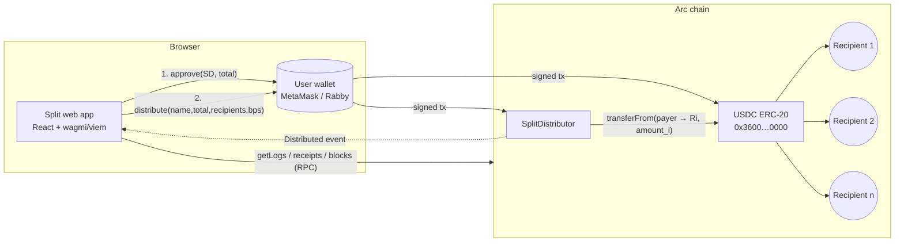

# Split — architecture

## Overview

Split has two parts, both generated in Arc Studio (session `split`,
https://studio.arc.io/app/767489e9-b81c-4ccf-a5df-94881d408a4d):

1. **`SplitDistributor`** (`contracts/SplitDistributor.sol`): a small, ownerless Solidity contract.
2. **Web app** (`src/`): Vite + React + TypeScript + wagmi/viem. It has no backend and no database, so the chain is the only source of truth.

## Payment flow

| Step | Where | What happens |
|---|---|---|
| Edit | browser | Recipients, percentages and the total are validated with bigint math that mirrors the contract (`src/lib/allocation.ts`, `src/lib/validation.ts`). |
| Review | browser | Every recipient, percentage and exact amount is shown, plus the network, a gas estimate and an irreversibility notice. You must confirm explicitly. |
| Approve | wallet → USDC | `approve(SplitDistributor, total)` for the **exact** total, never unlimited. The app waits for the receipt and re-reads the allowance before continuing. |
| Distribute | wallet → SplitDistributor | `simulateContract` runs first to surface revert reasons. Then `distribute(...)` is sent, the app waits for the receipt, and decodes `Distributed` from that receipt. |
| Receipt | browser | `/d/:id` is rebuilt from the onchain event, the transaction receipt and the block timestamp. |

## Contract design

- **Non-custodial and atomic.** `safeTransferFrom(payer, recipient_i, amount_i)` pays each recipient directly, so the contract never holds USDC. If any transfer fails, the whole call reverts.
- **Pinned token.** `usdc` is `immutable` and set in the constructor, so a user cannot pass a different token address.
- **No privileges.** There is no owner, admin, pause, upgrade, fee or withdraw function.
- **Units.** Amounts use USDC's 6-decimal ERC-20 units, and allocations are basis points (10 000 = 100%).
- **Rounding.** Recipients `0..n-2` get `floor(total × bps / 10000)`, and the last recipient gets the remainder. Amounts always sum exactly to `total`, and a share that rounds to zero reverts (`AllocationRoundsToZero`).
- **Limits.** `MAX_RECIPIENTS = 50`, measured at about 1.82M gas for a 50-recipient distribution (Foundry gas test).
- **State.** The only stored state is `distributionCount`. Everything else lives in the `Distributed` event (id, payer, nameHash, name, total, recipients, bps, amounts), which is emitted after the transfers and therefore only exists for successful distributions.

## Arc specifics

USDC on Arc is both the native gas token (an 18-decimal view) and an ERC-20 at
`0x3600000000000000000000000000000000000000` (a 6-decimal view). These are one balance seen two ways,
so the app never adds them together. The contract uses only the ERC-20 view.

## Code layout

| Path | Purpose |
|---|---|
| `contracts/SplitDistributor.sol` | Contract |
| `contracts/test/` | Foundry tests (mocks live only here) |
| `src/config/networks.ts`, `src/config.ts` | Env-driven Arc network and wagmi config |
| `src/abi/` | ABIs |
| `src/lib/allocation.ts` | Allocation math (vitest-tested) |
| `src/lib/validation.ts` | Client-side checks that mirror the contract |
| `src/lib/history.ts` | `Distributed` log reader (newest-first, chunked) |
| `src/components/create/` | Editor → Review → Approve → Distribute steps |
| `src/pages/` | Landing, Dashboard, Create, Activity, Receipt, How it works |
| `arc-studio/prompts/` | Every prompt sent to Arc Studio, in order |
